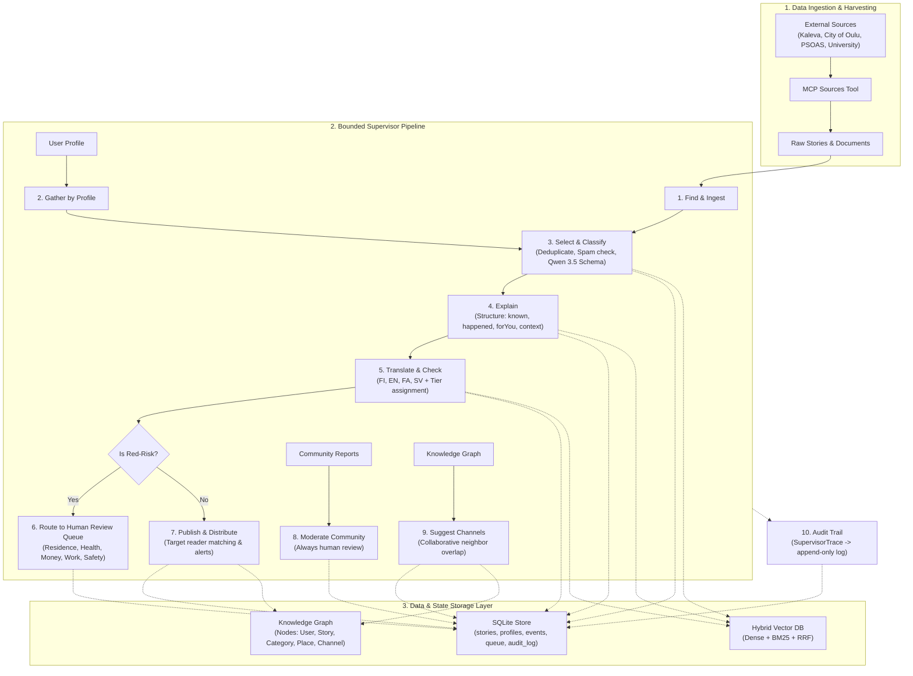

# Pinni — Agent & Track B

This documentation details the **Model Context Protocol (MCP) functions** and the **Supervisor Agent Architecture** implemented for Track B of Pinni.

---

## 1. Model Context Protocol (MCP) Tools

All MCP tools are implemented according to the **MCP JSON-RPC 2.0** specification in [`MCPServer`](file:///home/arshix/projects/pini/Pinni/agent/pinni_agent/mcp/server.py#L30-L362) and consumed via [`MCPClient`](file:///home/arshix/projects/pini/Pinni/agent/pinni_agent/mcp/client.py#L10-L18). The server exposes protocol handshake (`initialize`), tool discovery (`tools/list`), and execution (`tools/call`).

| # | Tool Name | Description | Key Inputs | Module / Handler |
|---|---|---|---|---|
| 1 | `gather_news` | Ingests news from external RSS and local portals (Kaleva, City of Oulu, PSOAS, University) based on location and topic preferences. | `location` (str), `categories` (list[str]), `source` ("all"\|"kaleva"\|"oulu"\|"psoas"\|"university") | [`sources.py`](file:///home/arshix/projects/pini/Pinni/agent/pinni_agent/mcp/tools/sources.py) |
| 2 | `gather_by_profile` | Personalized scraper dispatcher that triggers specific source scrapers based on user profile (e.g. PSOAS tenant $\to$ PSOAS site; university student $\to$ campus news) and indexes them. | `userId` (str, required) | [`gather_by_user_profile`](file:///home/arshix/projects/pini/Pinni/agent/pinni_agent/mcp/tools/sources.py#L182-L215) |
| 3 | `store_in_vector_db` | Batches news items or raw documents, generates embeddings, and inserts them into the vector database. | `items` (list[dict], required) | [`store_gathered_in_vector_db`](file:///home/arshix/projects/pini/Pinni/agent/pinni_agent/mcp/tools/sources.py#L217-L232) |
| 4 | `vector_search` | Hybrid search combining dense cosine vector similarity and BM25 lexical ranking with Reciprocal Rank Fusion (RRF). | `query` (str, req), `category`, `scale`, `placeId`, `risk`, `limit` (int) | [`vector_search`](file:///home/arshix/projects/pini/Pinni/agent/pinni_agent/mcp/tools/stores.py#L9-L40) |
| 5 | `geocode_place` | Maps free-text place names to canonical IDs, scales (`area`, `city`, `finland`, `world`), centroid GPS coordinates (`lat`, `lon`), and bounding radius. | `placeName` (str, required) | [`geocode_place`](file:///home/arshix/projects/pini/Pinni/agent/pinni_agent/mcp/tools/geo.py#L65-L83) |
| 6 | `query_knowledge_graph` | Read-only graph query engine supporting interaction history, collaborative filtering, similar reader discovery, and channel suggestions. | `queryType` (`user_interactions` \| `similar_readers` \| `suggested_channels` \| `collaborative_stories`), `userId`, `limit` | [`query_knowledge_graph`](file:///home/arshix/projects/pini/Pinni/agent/pinni_agent/mcp/tools/stores.py#L42-L70) |
| 7 | `record_interaction` | Records reader interaction events (dwell, open, like, share, reject) in SQLite and projects edges into the Knowledge Graph. | `id` (str), `userId` (str), `type` (str), `storyId` (opt), `channelId` (opt), `value` (float) | [`_handle_record_interaction`](file:///home/arshix/projects/pini/Pinni/agent/pinni_agent/mcp/server.py#L278-L282) |
| 8 | `create_draft` | Stores story drafts, assesses topic risk level (`red`, `amber`, `none`), and automatically enqueues red-risk items to human editorial queue. | `story` (dict, req), `trail` (list[dict]) | [`create_story_draft`](file:///home/arshix/projects/pini/Pinni/agent/pinni_agent/mcp/tools/publishing.py#L55-L75) |
| 9 | `route_to_human` | Pushes an item (`agentDraft`, `communityReport`, or `readerFlag`) to the human editor review queue with safety risk tag and audit trail. | `id` (str), `kind` (enum), `risk` (enum), `trail` (list[dict]) | [`route_to_human_queue`](file:///home/arshix/projects/pini/Pinni/agent/pinni_agent/mcp/tools/publishing.py#L33-L53) |
| 10 | `suggest_channels` | Computes collaborative channel recommendations using neighbor overlap in the Knowledge Graph. | `userId` (str, req), `limit` (int) | [`suggest_channels`](file:///home/arshix/projects/pini/Pinni/agent/pinni_agent/knowledge/graph.py#L265-L310) |

---

## 2. Agent Structure & Architecture

The Pinni agent follows the **Bounded Supervisor Orchestrator** pattern implemented in [`Supervisor`](file:///home/arshix/projects/pini/Pinni/agent/pinni_agent/agent/supervisor.py#L31-L298).



### Core Pipeline Tasks (B3)

1. **Find** ([`Supervisor.find`](file:///home/arshix/projects/pini/Pinni/agent/pinni_agent/agent/supervisor.py#L56-L77)): Searches candidate items across vector database and sources filtered by category, scale, and location.
2. **Gather by Profile** ([`Supervisor.gather_by_profile`](file:///home/arshix/projects/pini/Pinni/agent/pinni_agent/agent/supervisor.py#L79-L90)): Pulls tenant housing notices, university campus bulletins, and personal interest feeds tailored to the reader.
3. **Select & Classify** ([`Supervisor.select`](file:///home/arshix/projects/pini/Pinni/agent/pinni_agent/agent/supervisor.py#L93-L120)): Deduplicates incoming articles, filters out noise/spam, runs Ollama Qwen 3.5 with strict JSON schema to classify category, scale, need, and safety risk; drops irrelevant items with a logged explanation.
4. **Explain** ([`Supervisor.explain`](file:///home/arshix/projects/pini/Pinni/agent/pinni_agent/agent/supervisor.py#L122-L132)): Generates structured sections (`known`, `happened`, `notKnown`, `forYou`, and `context` question/answer card).
5. **Translate + Check** ([`Supervisor.translate_and_check`](file:///home/arshix/projects/pini/Pinni/agent/pinni_agent/agent/supervisor.py#L134-L147)): Translates stories across Finnish, English, Persian (Farsi), and Swedish; performs back-translation consistency checks and assigns translation tiers (Tier 1 Human, Tier 2 Verified, Tier 3 Machine).
6. **Route to Human** ([`Supervisor.route_to_human`](file:///home/arshix/projects/pini/Pinni/agent/pinni_agent/agent/supervisor.py#L149-L173)): Enforces editorial safety rules: items touching residence, health, money, work, or safety are automatically sent to the human review queue.
7. **Distribute** ([`Supervisor.distribute`](file:///home/arshix/projects/pini/Pinni/agent/pinni_agent/agent/supervisor.py#L175-L187)): Matches published stories with reader interest profiles and locations to dispatch personalized notifications.
8. **Moderate Community** ([`Supervisor.moderate_community`](file:///home/arshix/projects/pini/Pinni/agent/pinni_agent/agent/supervisor.py#L189-L199)): Triages reader reports and flags sensitive material for editorial moderation.
9. **Suggest Channels** ([`Supervisor.suggest_channels`](file:///home/arshix/projects/pini/Pinni/agent/pinni_agent/agent/supervisor.py#L201-L211)): Traverses the Knowledge Graph to find users with similar reading patterns and suggests community channels they follow.
10. **Audit** ([`Supervisor.audit_log`](file:///home/arshix/projects/pini/Pinni/agent/pinni_agent/agent/supervisor.py#L213-L215)): Appends every decision, model reasoning trace, and status transition into an immutable audit trail (`audit_log`) for editorial inspection.

---

## 3. Recommendation Subsystem

The recommendation engine ([`RecommendationEngine`](file:///home/arshix/projects/pini/Pinni/agent/pinni_agent/recommender/engine.py#L18-L122)) blends multiple ranking signals:
- **Hybrid Scoring** ([`score_story`](file:///home/arshix/projects/pini/Pinni/agent/pinni_agent/recommender/ranker.py#L16-L105)): Combines semantic profile match (vector search) with collaborative community interest (Knowledge Graph).
- **Time Decay** ([`calculate_time_decay`](file:///home/arshix/projects/pini/Pinni/agent/pinni_agent/recommender/ranker.py#L107-L119)): Exponential half-life decay (default 24h) balancing freshness against historical engagement.
- **Hard Filters** ([`should_filter_story`](file:///home/arshix/projects/pini/Pinni/agent/pinni_agent/recommender/filters.py#L29-L47)): Discard rejected categories, tags, or sources explicitly hidden by the user.
- **Must-See Override**: Emergency and vital local announcements (e.g. safety near user's area) always rank at the top regardless of personalization.
- **Cold-Start Learner** ([`Learner`](file:///home/arshix/projects/pini/Pinni/agent/pinni_agent/recommender/learner.py#L15-L109)): Smoothly transitions from onboarding profile weights to behavioral weights as interaction count increases.
- **Exploration Rate**: Reserves 10–15% of the feed for stories outside top preferences to prevent filter bubbles.

---

## 4. Running & Verification

Run tests from the `agent/` folder:

```bash
cd agent
# Run complete test suite:
uv run pytest -v

# Run interactive test scripts:
uv run python groovy_tests/test_a_recommender.py
uv run python groovy_tests/test_b_supervisor.py
uv run python groovy_tests/test_c_mcp.py
```
