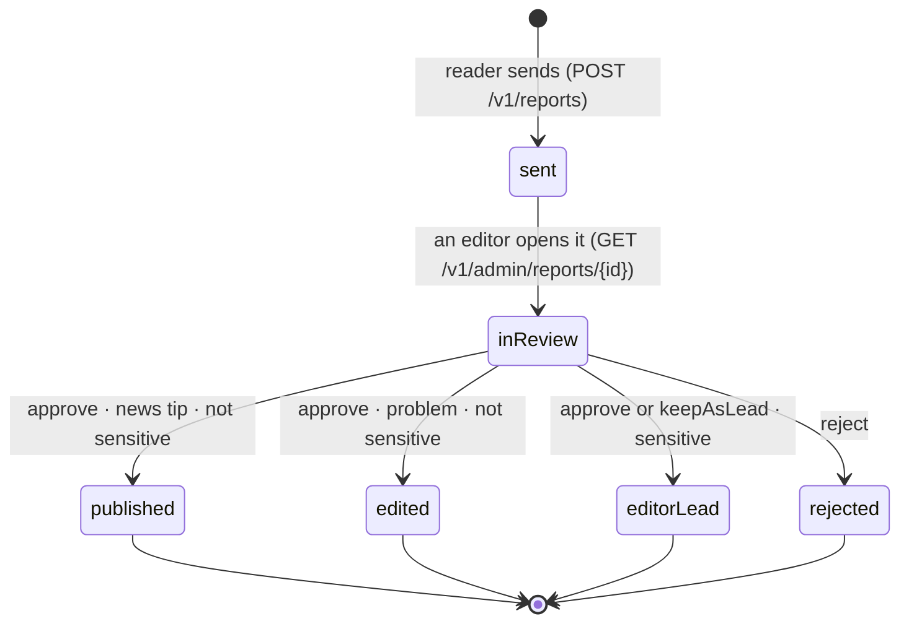

# Report review

How a reader's report becomes news, or does not. Every report is checked by a human editor before anything is published.
Owners: app (Track A) sends and shows reports; backend + admin page (Track C) store, review and notify; agents (Track B) may draft the story for an approved tip.

## States

| Status | Meaning for the reader | Set by |
|---|---|---|
| `sent` | Received, waiting for an editor | backend, on POST |
| `inReview` | An editor is looking at it | backend, when an editor first opens it |
| `published` | It is a story now (`resultStoryId`), on the map for its area | editor decision |
| `edited` | The story they flagged was corrected (`resultStoryId` = that story) | editor decision |
| `editorLead` | Kept private as a lead; nothing is published | editor decision |
| `rejected` | Not published; `editorNote` says why | editor decision |

## Steps

1. **Reader sends** a news tip or a problem with a story: topic, text (1–4000 characters), and for news tips optionally their area.
   The app never sends an exact point: an area is at least 300 m in radius. Problem reports carry no location.
2. **Backend stores** it with status `sent`, `history = [sent]`, and sets `sensitive`: always for the safety category.
   It appears in the admin queue (`GET /v1/admin/queue`, kind `communityReport`, risk red if sensitive).
3. **Editor opens** it in the admin page → `inReview` (appended to `history`).
4. **Editor decides** (`POST /v1/admin/reports/{id}/decision`):
   - approve a news tip → a community story is created (`origin: community`, `verification` = the editor), status `published`;
   - approve a problem → the story is corrected, status `edited`;
   - a sensitive report is never published: approve or keep as lead → `editorLead`;
   - reject → `rejected`, with an `editorNote` the reporter sees.
5. **Reporter is told the outcome**: the backend creates a `Notification` for the reporter
   (`reportPublished`, `reportCorrected`, `reportEditorLead` or `reportRejected`, with `reportId`) and pushes it when push exists (C5).
6. **Reader follows it** in the app: Profile → My reports (`GET /v1/reports/mine`) lists every report with its status;
   a report's page (`GET /v1/reports/{id}`) shows what they sent and its `history` step by step.

## Rules (checked by `tools/validate.py` on the mock data)

- `history` starts with `sent`, is in time order, and its last status equals `status`.
- Safety reports are sensitive; sensitive reports are never `published` or `edited`.
- `published` and `edited` reports have a `resultStoryId` that exists; a published tip's story has `origin: community`.
- Every decided report (published, edited, editorLead, rejected) has the matching notification for its reporter.
- News-tip areas are at least 300 m in radius; problem reports have no location.

## Demo (mock data, Track A)

No push yet: the app shows the outcome on My reports only. Debug builds have "Editor: approve / reject" on a report's page
so the flow can be shown without the admin page; an approved tip appears on the map for every mock reader.
